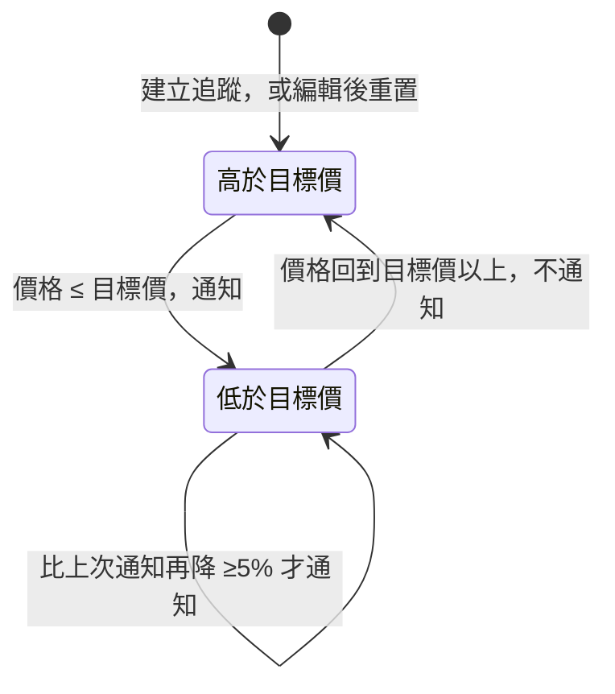
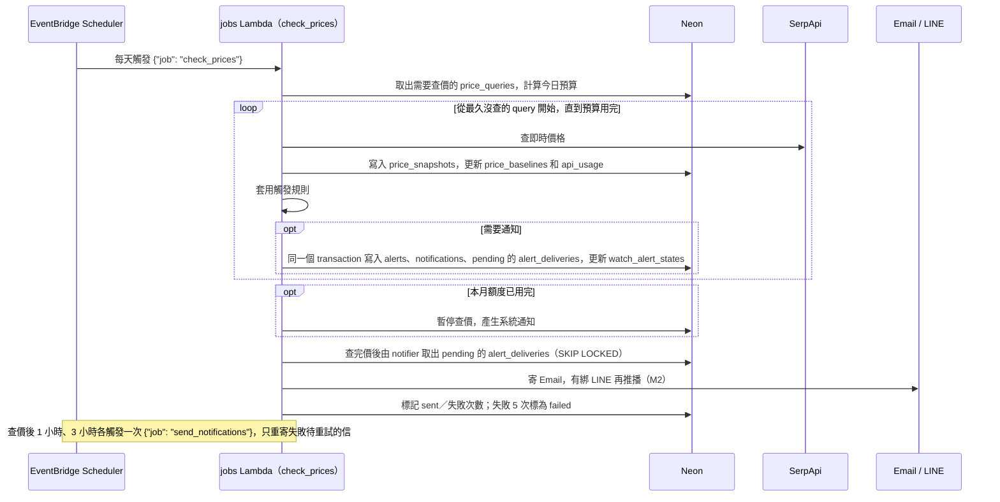
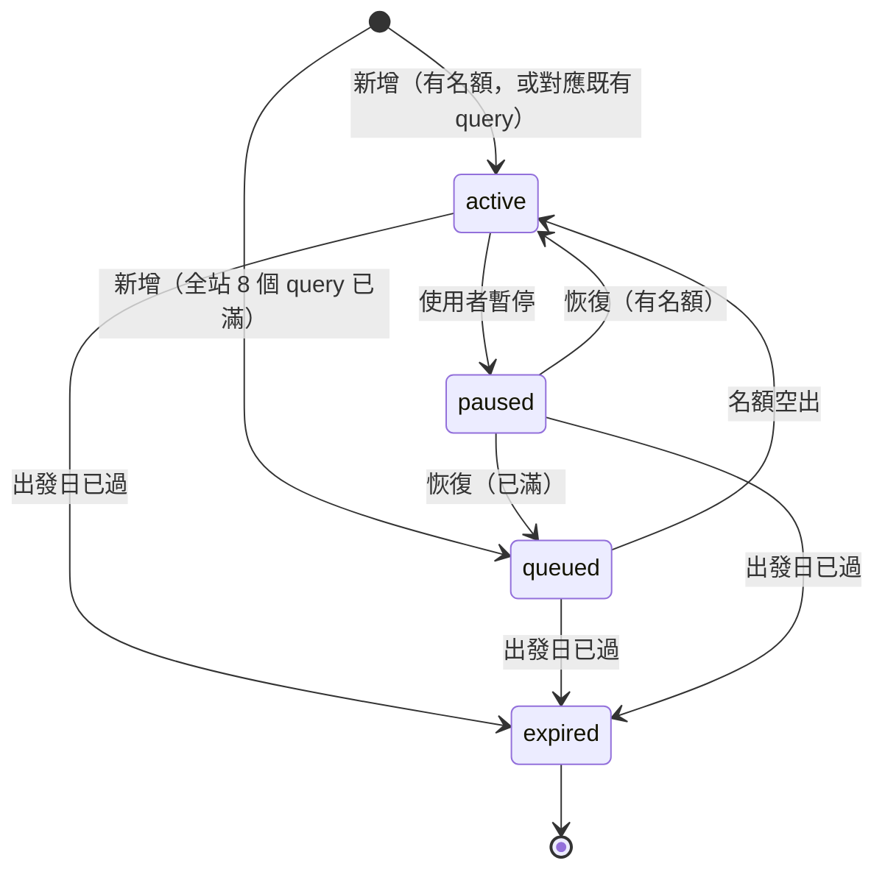
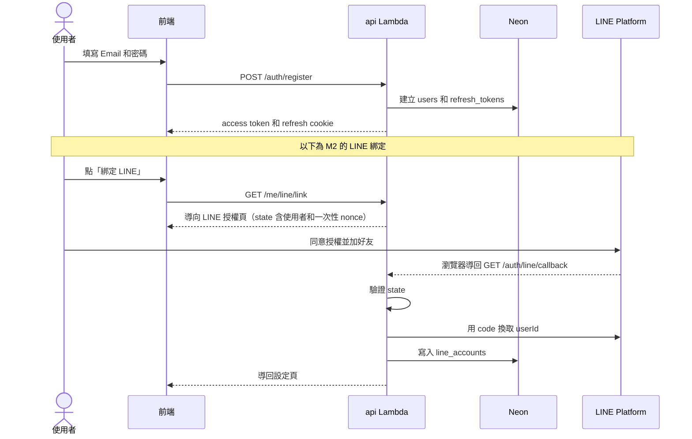
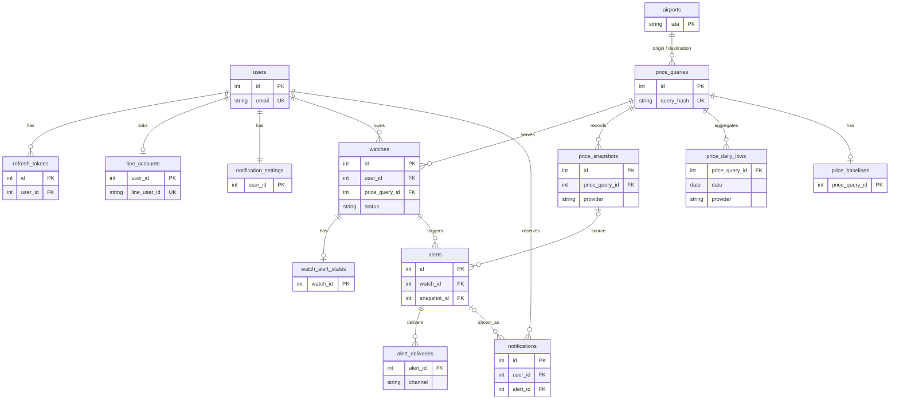

# 階段 2：系統設計（Design）

[← 回總覽](architecture.md)｜上一階段：[需求分析](01-requirements.md)｜下一階段：[開發實作](03-development.md)

## 技術選型
| 層 | 選擇 | 理由 |
|---|---|---|
| 前端 | React + TypeScript + Vite、TanStack Query、Recharts、Tailwind | 主流、型別安全、能純靜態部署到 S3；Recharts 用來畫價格圖 |
| 後端 | FastAPI + Mangum、SQLAlchemy 2.0 + Alembic、Pydantic、httpx | 非同步呼叫外部 API；Mangum 讓同一份程式在 Lambda 上執行；Alembic 讓本機 DB 和 Neon 結構一致 |
| DB | PostgreSQL 16：本機用 Docker，正式環境用 **Neon 免費版**（使用 pooler 連線） | 只換連線字串；pooler 避免 Lambda 併發時連線數爆量 |
| 背景任務 | EventBridge Scheduler 叫醒 jobs Lambda（每天查價、查價後 1 小時與 3 小時重寄、每天維護） | 取代 Celery/Redis，AWS 代管且免費；待寄的信記在 DB（寄件匣），不需要 SQS（見 [#7a 決策紀錄](architecture.md#2026-10-26-7a-決策紀錄)） |
| 容器 | 同一份 backend Dockerfile（AWS Lambda Python 基底）建出**單一架構** image：arm64 推到 **ECR** 給 Lambda，amd64 只在本機和 CI 建給 kind 用；frontend 用 Nginx image（只給 k8s 用） | Lambda 不接受 multi-arch manifest，build 時要加 `--provenance=false`；見下方〈容器執行方式〉 |
| k8s | **本機 kind + CI 驗證**，用 Helm chart 部署 | 單人維護正式環境的 k8s 成本高；用來學習和展示 |
| 網域／DNS | 自有網域，DNS 放 **Cloudflare**（免費） | Route 53 每月 US$0.50；Terraform 有 Cloudflare provider |
| Email | 正式環境用 **SES API**（`SesEmailSender`，靠 jobs Lambda 的 IAM 權限，自有網域 + Easy DKIM + 自訂 MAIL FROM）；本機預設 console 寄信器（只印 log）；SMTP 寄信器保留當備援 | 不需要任何長期密碼；`EmailSender` 介面讓三種寄信器只差設定（見 [#7b 決策紀錄](architecture.md#2026-10-26-7b-決策紀錄)） |
| IaC | Terraform（state 存 S3） | 一鍵建立／刪除所有資源 |

## 容器執行方式
| 環境 | 啟動方式 |
|---|---|
| Lambda（arm64） | 基底 image 預設的 Lambda runtime 進入點，api 經 Mangum 執行；api、jobs 兩個 Lambda 用不同 handler（`app.lambda_handlers.api_handler`／`jobs_handler`），機密在冷啟動時從 SSM 讀進環境變數 |
| 本機 docker-compose、k8s（amd64） | 覆寫 ENTRYPOINT 和 CMD 為 `uvicorn app.main:app`（基底 image 的預設進入點是 Lambda runtime）；排程工作用 `python -m app.jobs.*`，在 k8s 用 CronJob 執行 |

## 系統架構（正式環境）
架構圖放在[總覽的〈系統架構圖〉](architecture.md#系統架構圖)，以下是各條路徑的細節。

```
使用者 ──► Cloudflare DNS（hao007186.com，DNS only）──► CloudFront（ACM 憑證，us-east-1）──► S3（React 靜態檔，只有 CloudFront 能讀）
                                              │ 前端網址（沒有副檔名）由 CloudFront Function 改寫成 /index.html
                                              │ /api/*、/line/webhook
                                              │ 轉發時加上 X-Origin-Verify 密鑰標頭
                                              ▼
                       Lambda Function URL（auth NONE）──► Lambda: api（FastAPI + Mangum，含 LINE webhook 路由）
                                                          └ middleware 檢查 X-Origin-Verify，不符回 403

EventBridge Scheduler（每天）──► Lambda: jobs {"job": "check_prices"}
     1. 取出需要查價的 price_queries（有啟用中的 watch、非示範資料、出發日 > 今天 + 2 天）
     2. 計算今日預算，從最久沒查的 query 開始呼叫 SerpApi
        → 寫入 price_snapshots 並更新 price_baselines
     3. 套用觸發規則 → 需要通知時，在同一個 transaction 寫入 alerts、站內通知（notifications）
        與待寄紀錄（alert_deliveries，pending）
     4. 額度用完 → 暫停查價，對受影響的使用者發系統通知（每人每月一次）
     5. 最後由 notifier 取出 pending 的 alert_deliveries ──► Email（SMTP）+ LINE Messaging API（M2，有綁定才發）
        （DB 是寄件匣：每封信各自記錄狀態與嘗試次數，失敗 5 次標為 failed）
EventBridge Scheduler（查價後 1 小時、3 小時）──► Lambda: jobs {"job": "send_notifications"}
     - 只重寄之前失敗、待重試的信；只排兩次，避免頻繁叫醒 Neon
EventBridge Scheduler（每天）──► Lambda: jobs {"job": "maintenance"}
     - 出發日已過的 watch 標記為 expired
     - 標記過期後補位（平時名額空出時已經立刻補位）
     - 超過保留期限的 price_snapshots 彙總成每日最低價後刪除（延後，資料量需要時再做）

所有 Lambda ──► Neon PostgreSQL（新加坡區，pooler），Lambda 不放進 VPC，用 TLS 連線
機密資料 ──► SSM Parameter Store 標準版（含 X-Origin-Verify 密鑰），Lambda 冷啟動時讀取
請求大小上限 64 KB（middleware 回 413）
CloudWatch：錯誤（含 jobs Lambda 執行失敗）、額度、寄送失敗的通知信 → SNS 寄 Email 告警
```

## 核心邏輯設計

### 額度策略
- **只用 SerpApi**，每月 250 次為硬上限。原本規劃用 Travelpayouts 當雷達，M0 實測後不採用（見[總覽〈M0 實驗決策紀錄〉](architecture.md#m0-實驗決策紀錄2026-10-10)）。
- **每天排程一次，輪流查價**：每次執行先向 SerpApi 查剩餘次數（`/account.json`，不花額度），今日預算 = `ceil(剩餘次數 ÷ 本月剩餘天數（含今天）)`，從最久沒查的 query 開始查，查到預算用完為止。無條件進位讓月底剩少量額度時仍能每天查，預算也永遠不超過剩餘次數。
- **防止重複查價**：每個 query 查價前先用條件式更新「搶下」（台灣時間今天還沒查過才搶得到），每個 query 各自 commit；失敗時還原 `last_checked_at`，明天優先重查；連續 3 次失敗就停止。排程重試或兩個程式同時跑都不會重複花額度。
- **一次查價只花 1 次呼叫**：來回票的第一次回應就包含來回總價和 `price_insights`，不再用 `departure_token` 查回程；訂票連結使用回應中的 Google Flights 網址，不花額度換 `booking_token`。2026-10-20 已用真實回應確認（見[總覽〈M0 SerpApi 實驗紀錄〉](architecture.md#m0-serpapi-實驗紀錄2026-10-20)）。
- **用量估算**：250 次／月約等於每天 8 次，所以每個 query 大約每「active query 數 ÷ 8」天查到一次。全站上限訂為 **8 個** active price_query，讓每個 query 每天都查得到；放寬到 20 個的話會變成約 2.5 天一次。
- **額度用完**：暫停查價到下個月 1 號，並發一則系統通知。動態預算正常運作時額度不會提前用完，發生時要檢查是否有異常重試。
- 相同條件的追蹤合併成同一個 price_query，額度只花一次。
- 用量記錄在 `api_usage`（僅供紀錄，預算以 SerpApi 回報的剩餘次數為準）；供應商用 `PriceProvider` 介面（adapter pattern）抽象化，v1 有 mock 和 SerpApi 兩個實作。

### 價格基準
比較的一律是**同一個 price_query（同一個出發日期）**的價格，不跨日期平均。

| 用途 | 資料來源 |
|---|---|
| 「便宜」的判斷 | SerpApi `price_insights.typical_price_range` 的下緣（Google 的典型價格區間），每次呼叫 SerpApi 時更新 |
| 歷史最低價 | 冷啟動用 `price_insights.price_history` 的最低值當起點，之後用自己累積的 **SerpApi 價格**持續更新 |

- Google 沒有提供 `price_insights` 時（冷門航線、出發日很遠）：只用目標價觸發；「歷史新低」要等累積到至少 3 筆 SerpApi 價格才開始判斷；頁面顯示「歷史資料累積中」。

### 觸發與去重（狀態變化才通知）
每次 SerpApi 查到價格後套用以下規則。觸發原因有三種：

| 原因 | 條件 |
|---|---|
| `below_target` | 價格**從高於變成 ≤ 目標價**（狀態變化） |
| `below_typical` | 價格**從典型區間內變成低於典型區間下緣**（狀態變化） |
| `record_low` | 價格低於歷史最低價（需有足夠樣本；跟這筆價格併入之前的歷史最低比較） |

- **初始狀態**：新追蹤的 `below_target`、`below_typical` 都是 false（視為「高於」），所以第一次確認的價格若已符合條件，會通知 1 次。
- **有狀態變化就通知**：`below_target` 或 `below_typical` 由 false 變成 true 時，一定通知。
- **沒有狀態變化時套用 5% 門檻**：持續低於目標價或典型區間，或只是創下歷史新低時，要**比上次通知的價格（`last_notified_price`）再降 ≥5%** 才再通知。三種原因共用這個門檻，所以連續小幅創新低不會每次都通知。watch 從未通知過時，`record_low` 直接通知。
- **一筆價格只產生一則 alert**：同時符合多個原因時合併成一則，`alerts.reason` 記主要原因（優先順序 `below_target` > `record_low` > `below_typical`），其餘原因寫在通知內文。
- 價格回到目標價以上 → `below_target` 重置；回到典型區間內 → `below_typical` 重置。之後再跌破，視為新的一次。
- 每個 watch 的狀態記錄在 `watch_alert_states`；沒有資料 = 初始狀態，重置就是刪掉那筆。
- 只對 `active` 的追蹤判斷；查不到航班時不判斷。
- 冪等：`alerts` 唯一鍵（watch_id + snapshot_id）+ `alert_deliveries` UQ(alert_id, channel)，重送不會重複發送；notifier 用 `FOR UPDATE SKIP LOCKED` 取信，兩個同時跑也不會寄兩次。
- 系統通知（追蹤從排隊中啟用、額度用完）只發站內通知，不寄 Email。
- 收到 LINE unfollow 事件 → 停止 LINE 推播，並產生一則系統通知。

**通知狀態機（`watch_alert_states.below_target`）：** `below_typical` 的形狀相同，把「目標價」換成「典型區間下緣」即可。



**查價到通知的時序：**



### 追蹤的生命週期
| 狀態 | 說明 |
|---|---|
| `active` | 正常查價 |
| `queued` | 排隊中：全站佔名額的 price_query 已滿 8 個，暫不查價；名額空出時立刻依建立時間轉為 `active` |
| `paused` | 使用者暫停，不查價 |
| `expired` | 出發日已過，由每日排程自動標記；前端收到「歷史紀錄」分頁，價格圖保留 |



（使用者可以在任何狀態刪除追蹤，圖中省略。）

- 出發日在 2 天內就停止查價（價格已無參考價值，把額度省下來）。
- 新增或編輯追蹤時，依條件（出發地、目的地、去回程日期、艙等、人數、航空公司、是否為示範資料）算出 `query_hash`：已存在就沿用該 price_query，否則建立新的，再把 `watches.price_query_id` 指過去。改日期等於換一個查詢，價格歷史從頭累積。
- 編輯目標價、日期或其他查價條件後，該 watch 的 `watch_alert_states` 重置為初始狀態，避免沿用舊條件的通知狀態。
- 新追蹤若對應到已經在查價的 price_query，不佔新名額，直接 `active`；需要新 query 而全站已滿時才進 `queued`。恢復 `paused` 的追蹤時套用同樣規則。
- **佔名額**：price_query 至少有 1 個 `active` 追蹤、不是示範資料，而且出發日在 2 天以後。出發日在 2 天內的 query 已停止查價，不佔名額；這類排隊中的追蹤也不會被啟用，等著被標成過期。
- **立刻補位**：新增、編輯、暫停、恢復、刪除後，在同一個 transaction 內依建立時間啟用排隊中的追蹤（同一個 query 的排隊者一起啟用）；每日維護只處理過期釋出的名額。這些操作先取得全站 advisory lock，避免兩個請求同時讀到「還有空位」。詳見 [#3 設計](superpowers/specs/2026-10-23-m1-watches-design.md)
- 沒有任何 `active` watch 的 price_query 不再查價，但保留價格歷史。

## 帳號與驗證設計
- v1：註冊、登入、Argon2、JWT access token（15 分鐘）+ refresh token（7 天，HttpOnly + `Secure` + `SameSite=Strict` Cookie，存 DB，可撤銷）、登出、連續失敗 5 次鎖 15 分鐘
- **不做 Email 驗證**（2026-10-23 決定，見[總覽〈2026-10-23 決策紀錄〉](architecture.md#2026-10-23-決策紀錄)）：註冊後直接登入
- **示範帳號**：`POST /auth/demo` 直接取得示範帳號的 session；除了登出和 refresh 以外，所有寫入 API 對示範帳號回 403；資料由 seed 腳本預先建立（多個追蹤 + 價格歷史 + 通知），不會被 checker 查價
- LINE 綁定：`GET /me/line/link` → LINE 授權頁（`bot_prompt=aggressive` 引導加好友）→ callback 驗證 `state`（使用者 + 一次性 nonce）→ 寫入 `line_accounts`
  - LINE Login channel 和 Messaging API channel **必須建在同一個 Provider 底下**，兩邊的 `userId` 才會一致
- v2：忘記密碼、LINE 登入（共用同一個 callback，用 `state` 區分）
- 權限：資料一律檢查 owner；`admin` 只能看用量和統計

**註冊到綁定 LINE 的時序：**



## 資料模型
圖中只畫資料表之間的關聯和主鍵、外鍵、唯一鍵，型別僅為示意；完整欄位以圖下方的清單為準。`airlines` 和 `api_usage` 沒有外鍵關聯，所以不在圖中。



- `users`(id, public_id, email UQ, password_hash, display_name, role, is_demo, is_active, failed_login_count, locked_until, timestamps)
- `refresh_tokens`(id, user_id, token_hash, expires_at, revoked_at)
- `line_accounts`(user_id PK/FK, line_user_id UQ, display_name, is_friend, linked_at)
- `notification_settings`(user_id PK, email_enabled 預設 true)：沒有資料 = 預設值；`line_enabled` 於 M2 加入
- `airports`(iata PK, name_zh, city_zh, country)、`airlines`(iata PK, name_zh)：精選清單，資料放在 `backend/app/seeds/data/*.csv`
- `price_queries`(id, query_hash UQ, origin, destination, depart_date, return_date, cabin, adults, airlines（排序後的 IATA 陣列，空 = 全部）, is_demo, last_checked_at)：查價條件只存在這裡；`adults` 和 `is_demo` 都納入 `query_hash`，人數不同的追蹤不會合併，示範資料也不會和真實查詢共用同一筆
- `watches`(id, public_id, user_id, **price_query_id FK**, **target_price NOT NULL**, **status**(active/queued/paused/expired), timestamps)：不重複存查價條件；單程／來回由 `return_date` 判斷，v1 一律 TWD
- `price_snapshots`(id, price_query_id, provider, price, airline_iata, stops, booking_url, observed_at)：只新增不修改；價格一律 TWD
- `price_daily_lows`(price_query_id, date, provider, min_price, currency)，PK(price_query_id, date, provider)：超過保留期限的 snapshots 彙總到這裡（延後，資料量需要時再做）
- `price_baselines`(price_query_id PK, typical_low, typical_high, record_low, history_seeded, sample_count, updated_at)：`history_seeded` 表示歷史最低已用 Google 的 `price_history` 打底
- `watch_alert_states`(watch_id PK, below_target, below_typical, last_notified_price, last_notified_at)：沒有資料 = 初始狀態；刪除追蹤時一起刪除
- `alerts`(id, watch_id, snapshot_id, reason, price, created_at, UQ(watch_id, snapshot_id))：價格警示的業務紀錄；`reason` 是主要原因；`price` 自帶一份，snapshot 因保留期限被刪除時 `snapshot_id` 設為 NULL
- `notifications`(id, public_id, user_id, type(price_alert/system), title, body, link, alert_id NULL, dedupe_key NULL, is_read, created_at, UQ(user_id, dedupe_key))：站內通知中心；`dedupe_key` 防止系統通知重複（例如 `quota_exhausted:2026-11`）；刪除追蹤後通知保留、`alert_id` 設為 NULL
- `alert_deliveries`(id, alert_id, channel, status(pending/sent/failed/skipped), attempts, last_error, sent_at, created_at)，UQ(alert_id, channel)：notifier 的寄件匣；`last_error` 已遮掉 SMTP 密碼
- `api_usage`(provider, month, count)

## API 草案（/api/v1，FastAPI 自動產生 OpenAPI 文件）
- Auth：`POST /auth/register|login|refresh|logout|demo`、`GET /me`
- LINE：`GET /me/line/link`、`GET /auth/line/callback`、`GET/DELETE /me/line`、`POST /line/webhook`
- Watches：`GET/POST /watches`（`?status=` 篩選）、`GET/PATCH/DELETE /watches/{id}`（PATCH 也用來暫停／恢復）、`GET /watches/{id}/prices?range=`、`GET /watches/{id}/baseline`、`GET /price-reference`（新增／編輯表單的參考價：完全相同條件的典型價格區間，不花額度）
- 通知：`GET /notifications`（`?watch_id=` 篩選某個追蹤的價格通知）、`PATCH /notifications/{id}/read`、`POST /notifications/read-all`、`GET/PATCH /me/notification-settings`
- 參考資料：`GET /airports`、`GET /airlines`；Admin：`GET /admin/usage`
- 健康檢查：`GET /health`

## 前端頁面
首頁（含「以示範帳號瀏覽」按鈕）→ 註冊／登入 → 我的追蹤列表（進行中／歷史紀錄分頁）→ 新增／編輯追蹤 → 追蹤詳情 → 通知中心（鈴鐺 + 未讀數）→ 設定（個人資料、LINE 綁定與 QR code、通知開關）

**示範帳號：** 頂部固定顯示「你正在使用示範帳號，資料為唯讀」；寫入按鈕照樣顯示但不能按，滑過去提示「示範帳號無法修改」，讓訪客看得到網站有哪些功能。版面以電腦為主，手機寬度能用即可。細節見 [#6 前端設計](superpowers/specs/2026-10-25-m1-frontend-design.md)。

**目標價參考價：** 新增／編輯表單填好查價條件後，若資料庫已有完全相同條件的典型價格區間就顯示在目標價下方，沒有就提示第一次查價後會顯示；不花查價額度。細節見 [目標價參考價設計](superpowers/specs/2026-10-26-m1-price-reference-design.md)。

**追蹤詳情的價格圖：** SerpApi 價格畫成主線，加上目標價線和典型價格區間色帶；下方列出最近通知和訂票連結。

## 附圖索引
| 圖 | 位置 |
|---|---|
| 系統架構圖 | [總覽〈系統架構圖〉](architecture.md#系統架構圖) |
| 通知狀態機、查價到通知的時序圖 | [〈觸發與去重〉](#觸發與去重狀態變化才通知) |
| 追蹤生命週期 | [〈追蹤的生命週期〉](#追蹤的生命週期) |
| 註冊到綁定 LINE 的時序圖 | [〈帳號與驗證設計〉](#帳號與驗證設計) |
| ERD | [〈資料模型〉](#資料模型) |

